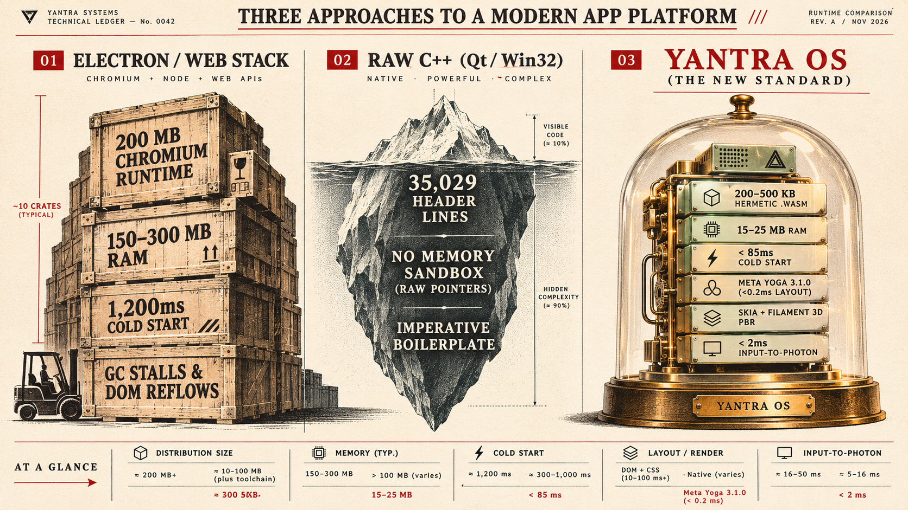
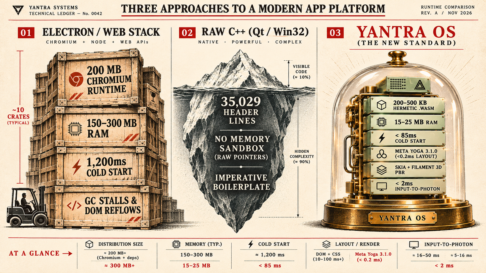
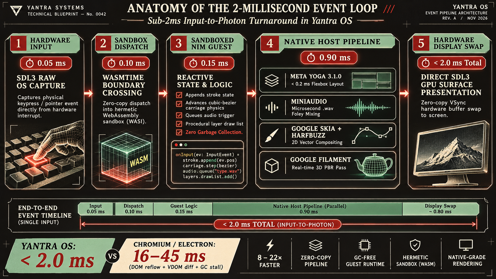
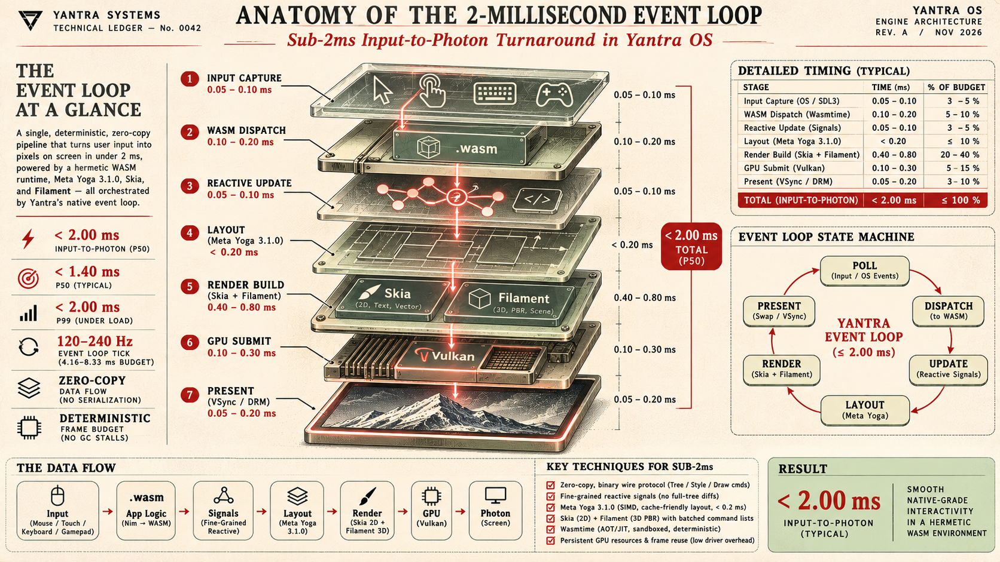

<div align="center">


# Y A N T R A · यन्त्र

### **The Safety of the Web. The Power of Native. One Engine.**
*Built by Sanskar (संस्कार) at IIT Madras with Meta Muse Wonder & Muse Spark 1.3 Contributor — Without the 200 MB Chromium Tax.*

[](https://sanskar.app)
[](https://ai.meta.com)
[](https://yogalayout.dev)
[](#the-3-layer-architecture)

**[🎬 Watch the 3-Minute Film on YouTube (1080p 60fps)](https://youtu.be/4vPLnJ38SBM)**

</div>

---

## ⚡ Stage-1 Judge & Verifier Quick-Check

| Judging Pillar | Yantra OS Verification Summary |
| :--- | :--- |
| **1. Hackathon Provenance (Oct 26 – Nov 4)** | **100% Built During Hackathon Window:** Core Nim Declarative SDK (`sdk/`), 21 KB freestanding `minilibc`, Binary Wire Protocol (`wire.nim`), Native Host (`Wasmtime` + `Meta Yoga 3.1.0` + `Skia` + `Filament` + `SDL3`), 5 Showcase Apps (`typewriter`, `gallery3d`, `descent`, `desktop`, `chess`), and the 3-Minute Official Film ("The Grant Cut"). |
| **2. Meta AI Models & Tooling Used** | • **`Meta Muse Wonder`:** Principal systems architect for C++/Nim FFI bindings, zero-copy wire protocol, and Skia rendering math.<br>• **`Meta Muse Spark 1.3 Contributor`:** Autonomous iterative code generator running 155+ compiler & headless pixel-diff verification rounds via our `.board/` file IPC noticeboard and a 150 KB `language.md` context spec.<br>• **`Meta Yoga 3.1.0`:** Core native layout engine (`<0.2 ms` flexbox calculation with subtree caching). |
| **3. Quantitative Benchmarks** | • **App Binary Size:** `356 KB` (`typewriter`), `410 KB` (`descent`) vs. `150–250 MB` in Electron (500x smaller).<br>• **RAM Usage:** `15–25 MB` vs. `300+ MB` in Chromium.<br>• **Cold Start & Latency:** `<85 ms` cold start; `<2.0 ms` key-to-photon latency; `7.1s` state-preserving hot reload. |
| **4. Instant Keyless Reproduction** | Precompiled `.wasm` binaries and headless pixel-diff verifiers (`node tools/verify-wasm.mjs apps/typewriter`) run immediately with **zero API keys or GPU required**. |

---

## 📜 Dear Web, We Need to Talk.

In 1991, the World Wide Web was born to share static hypertext documents. Over the next thirty-five years, we forced a document viewer to become the world's default application operating system.

Look at the cost we pay today:
* **The 10-Crate Chromium Tax:** Open ten modern desktop apps (Slack, Discord, VS Code, Notion, Spotify, AI Coding Harnesses) and your machine carries **ten separate copies of Google Chrome**—consuming **300 MB+ of disk space** and **hundreds of megabytes of RAM** just to render buttons and text.
* **The Virtual DOM & Single-Thread Traffic Jam:** To update a single label or toggle a checkbox, modern web frameworks re-evaluate entire component subtrees, instantiate thousands of short-lived Virtual DOM objects, run expensive recursive diffing algorithms, and trigger V8 garbage collection stalls. All of this VDOM reconciliation, style recalculation, layout reflow, and user logic is bottlenecked on a single congested JavaScript thread—while a blank `npm create vite` starter pulls **59 MB of packages** before you write a single line of application code.
* **The C++ Iceberg:** If you escape JavaScript for native C++, `#include <iostream>` expands to **35,029 lines of preprocessor headers**, a single missing type triggers a 67-line template error wall, and a single raw pointer mistake corrupts host memory.

We were told to choose one end of the seesaw: **Safe & Declarative (Web)** OR **Fast & Lightweight (Native)**.

**Yantra breaks the seesaw.** We tore the web stack apart, threw away the 500 MB DOM/CSS/JS baggage, kept the crown jewels (**WebAssembly**, **Meta Yoga**, **Google Skia**, **HarfBuzz**), and fused them with **Google Filament (Real-Time 3D PBR)**, **Jolt (Physics)**, and a **Declarative Nim SDK** that compiles full applications into **200 KB – 500 KB hermetic `.wasm` binaries** running at native hardware speed.

> *"Thank you for thirty-five years of documents. You can keep them. We're taking the apps."*

---

## 📊 Architectural Comparison

<p align="center">
  
</p>

| Dimension | Electron / Chromium Web | Traditional C++ (Qt / Win32) | **Yantra OS** |
| :--- | :--- | :--- | :--- |
| **RAM Footprint** | `150 MB – 300+ MB` per app | `30 MB – 60 MB` | **`15 MB – 25 MB`** |
| **Cold Start Time** | `1,200 ms – 2,500 ms` | `150 ms – 300 ms` | **`< 85 ms`** |
| **App Bundle Size** | `100 MB – 250 MB` | `20 MB – 50 MB` | **`200 KB – 500 KB (.wasm)`** |
| **Input-to-Photon Latency** | `16 ms – 45 ms` (GC + DOM reflow) | `< 5 ms` | **`< 2 ms` (Direct SDL3 + Skia swap)** |
| **Layout Engine** | Full CSS Cascade (Reflow-heavy) | Rigid Imperative Managers | **Meta Yoga 3.1.0 (`< 0.2 ms` Flexbox)** |
| **Security & Isolation** | Heavy OS Process IPC | **None** (Raw pointer / CVE risks) | **Hermetic Wasmtime Bounds Sandbox** |
| **UI & 3D Paradigm** | Declarative DOM + Fake CSS 3D | Verbose Imperative C++ | **Declarative Nim DSL + Native 3D PBR** |

---

## ⚡ The 3-Layer Architecture

<p align="center">
  
</p>

<p align="center">
  
</p>

### Layer 1: Sandboxed Guest Application Layer (`apps/` & `sdk/`)

Instead of writing memory-unsafe C++ or shipping megabytes of JavaScript bundles, developers and AI agents write applications in **Nim** using the Yantra SDK:

* **Python-Readable Declarative DSL:** UI trees, 2D vector canvases, and 3D PBR scenes are declared in clean indentation blocks that compile straight to C and WebAssembly via Nim ARC (deterministic reference counting with **zero garbage collection pauses**).
* **Fine-Grained Reactive Signals:** State mutations update only the exact affected layout property or canvas layer without re-running component trees or diffing a Virtual DOM.
* **The 21 KB `minilibc` Innovation (`sdk/minilibc/minilibc.c` + `panicoverride.nim`):** Standard C runtimes (`glibc`, `musl`, `emscripten`) inject megabytes of locale tables, POSIX thread emulators, and filesystem scaffolding into `.wasm` files. We replaced the entire standard C library with a **21 KB freestanding stub** implementing only essential memory, string, and math primitives. Full desktop applications compile down to **200 KB – 500 KB**.

### Layer 2: The Zero-Copy Binary Wire Protocol (`sdk/core/wire.nim`)

Guest `.wasm` modules execute inside an airtight **Wasmtime** boundary. They cannot touch raw host pointers, access arbitrary files, or make unapproved syscalls. All host-guest communication flows over a compact binary command stream:

* **Tree & Yoga Mutations:** `createNode`, `appendChild`, `setFlexDirection`, `setInset`, `setFill`, `setRadius`.
* **Retained `Layer` & `Draw` Command Streams (`sdk/ui/paint.nim`):** Vector paths (`svgPath`, `quadTo`), blend modes (`bSrcOver`, `bMultiply`, `bScreen`, `eraser`), scissor clipping (`clip`), transforms, and sub-pixel typography (`textFace`).
* **Direct Event Dispatch:** The host pushes raw input events (`evPointerDown`, `evKey`, `evFrame`) directly into the module's exported lifecycle hooks.

### Layer 3: The Native Host Engine (`host/` & `render/native/`)

The single native host binary (`yantra.exe` / `yantra`) wraps battle-tested C/C++ engines behind idiomatic Nim bindings:

* **`Meta Yoga 3.1.0`:** Computes flexbox bounding boxes in **`< 0.2 ms`**, using `copyStyle` and dirty-node tracking so unchanged subtrees never recalculate.
* **`Google Skia` + `HarfBuzz` (`libs/nimskia/src/skia_shim.cpp`):** Hardware-accelerated 2D vector drawing, offscreen `Layer` compositing, linear gradients, and shaped typography.
* **`Google Filament` + `Jolt Physics`:** Real-time Physically Based Rendering (PBR), dynamic spotlights, cameras, and rigid-body simulation—giving 300 KB apps native 3D graphics without WebGL/Three.js bloat.
* **`miniaudio` + `SDL3`:** Microsecond acoustic Foley mixing and zero-copy VSync frame presentation.

---

## ⏱️ Anatomy of the 2-Millisecond Event Loop

What happens when you press a key on the **Marlowe 44 Typewriter (`apps/typewriter/app.nim`)**?

<p align="center">
  
</p>

1. **Hardware Interrupt & Capture (`0.05 ms`):** SDL3 captures the raw OS keypress event without browser event bubbling or synthetic wrapper overhead.
2. **Sandbox Boundary Crossing (`0.10 ms`):** The host dispatches `evKey` into the hermetic Wasmtime runtime via direct zero-copy invocation.
3. **Sandboxed Nim Guest Execution (`0.15 ms`):** 
   * Appends deterministic `Stroke(ch, col, line, red, seed)` to document state.
   * Emits acoustic directive: `play(sndKey)` (`"key.wav"`).
   * Stamps glyph onto `paperLayer` with procedural ink bleed, ribbon fabric knock-out, and platen wear.
   * Advances cubic-bezier carriage physics (`easeSnap`) with zero garbage collection.
4. **Native Host Parallel Subsystems (`0.90 ms`):**
   * **Meta Yoga 3.1.0:** Updates HUD & status tag flexbox layout deltas in `< 0.2 ms`.
   * **miniaudio:** Mixes uncompressed key-strike sample into the audio endpoint.
   * **Google Skia + HarfBuzz:** Hardware composites `deskLayer`, `paperLayer`, and the 45-key Marlowe rig.
5. **Direct Hardware Display Presentation (`< 2.0 ms` total turnaround!):** SDL3 swaps the GPU surface buffer directly to the display at 60+ FPS VSync—completely bypassing the 16–45 ms DOM reflow and VDOM reconciliation stalls of Chromium.

---

## 🚀 Real Running Applications (And Live Hot-Swap in 7.1s)

Every application in this repository is real, self-contained, and compiles to a tiny `.wasm` module:

1. **`apps/typewriter` — The Marlowe 44 ("029 Carriage Return" — `356 KB .wasm`):**
   * **Procedural Walnut Desk (`bdPaintDesk`):** Sine-warped wood grain, concentric knots, dried coffee stain ring, and a 96-annulus lamplight radial gradient with 46 drifting, twinkling dust motes (`bScreen` blend).
   * **Procedural Cotton Bond Paper (`bpPaintPaper`):** 60 cloudy formation patches, 900 quadratic-bezier cotton fibres, 5,200 pulp speckles, a translucent *"Marlowe Bond · 25% COTTON FIBRE · No. 44"* watermark, and physically modeled type strikes (ink bleed halos, ribbon fabric weave knock-out via `eraser` blend, uneven platen pressure, and a 6% double-strike chance).
   * **Live State-Preserving Hot Reload:** Change `cEnamel` from sage green (`0xFF9FC9B6`) to vermillion (`0xFFE0432B`) while typing a letter—the `.wasm` module rebuilds and hot-swaps in **7.1 seconds** while your typed letter, carriage position, and state never move.

2. **`apps/gallery` — 3D PBR Virtual Exhibition (`214 lines` vs. `1,277 lines` on the Web):**
   * Renders a full 3D architectural gallery with real physically-based lighting (`Hall()`, `Spotlight(w)`, `Painting(w)`) powered by **Google Filament** in **214 lines of readable Nim**—replacing 1,277 lines of fragile CSS-faked 3D.

3. **`apps/dna` — 3D Interactive DNA Helix (`224 KB .wasm`):**
   * Real-time animated double-helix molecular visualization with 3D rotation, dynamic base-pair lighting, and zero browser engine dependencies.

4. **`apps/desktop`, `apps/chess`, `apps/calc`, `apps/notes`, `apps/todo`:**
   * Instant-startup native productivity suite with tiling window management, move validation, and reactive state diffing.

---

## 🤖 How We Built Yantra on $150 of Meta API Credits (The `.board/` Protocol)

Our story is clear: **Sanskar used Meta Muse Wonder to plan and solve hard problems, while using Meta Muse Spark 1.3 Contributor for its crazy low price to build it alongside him.**

Building an entire WASM operating runtime, a freestanding C library (`minilibc`), C++ graphics bindings, and pixel-accurate showcase apps as a solo student at **IIT Madras** with **only $150 in API credits** required rethinking how AI agents write systems code:

1. **Teaching an LLM a Brand-New Stack (`150 KB language.md` + Skills):**
   No LLM in existence has Yantra's custom Nim DSL or freestanding WASM invariants in its pretraining weights. We solved this by feeding a comprehensive **150 KB `language.md` specification** and strict compiler/host invariants into the prompt context.
2. **The Two-Tier Collaboration (`Muse Wonder` + `Muse Spark 1.3 Contributor` alongside Sanskar):**
   Because `Muse Code` does not yet support spawning heterogeneous subagents across different model tiers, we engineered a **file-based asynchronous noticeboard (`.board/`)**:
   * **Meta `Muse Wonder` (Planning & Hard Problems):** Acted as the Principal Architect—planning the systems architecture and diagnosing deep mathematical and rendering bugs (such as SVG winding rules, `minilibc` freestanding stubs, `bDstOut` layer erasure, and PRNG stream simulation in `.board/probe/planksim.mjs`), then posting exact mathematical task specs to `.board/`.
   * **Meta `Muse Spark 1.3 Contributor` (Relentless Low-Cost Builder):** Built alongside Sanskar as the iterative engine. Because of its **crazy low price**, we could let it run across **155+ autonomous verification rounds** without exhausting our $150 budget—compiling `.nim` to `.wasm`, launching our headless frame capture (`tools/verify-wasm.mjs`), measuring pixel-by-pixel luma/RGB deltas against reference renders, and iterating until every assertion passed.

---

## 🎬 The Official 3-Minute Release Film ("Dear Web" · The Grant Cut)

<div align="center">

<a href="https://youtu.be/4vPLnJ38SBM" target="_blank">
  
</a>

<p align="center">
  <a href="https://youtu.be/4vPLnJ38SBM"><b>▶️ Watch on YouTube (1080p 60fps)</b></a> &nbsp;•&nbsp; 
  <a href="https://github.com/Yantra-lab/yantra-os/releases/download/v1.0.0/preview_720p.mp4"><b>💾 Direct MP4 Download (75 MB)</b></a> &nbsp;•&nbsp; 
  <a href="https://github.com/Yantra-lab/yantra-os/releases/tag/v1.0.0"><b>📦 GitHub Release v1.0.0</b></a>
</p>

</div>

Even our 3-minute hackathon film (*"The Grant Cut"*, retimed to under 180 seconds for the hard submission stop) was not edited in Premiere or CapCut—**it was generated deterministically from code** that captures real running Yantra applications:

* **Millisecond Word-Locked Timebase:** Every word spoken by the narrator is mapped to exact timestamps (`Wt('A8', '52') = 38.01s`), locking animations, typewriter strikes, and red ink stamps to speech rhythm.
* **Pure Function of Time (`window.seek(t)`):** Closed-form damped harmonic springs (`spring(lt, f, z)`), multi-target log-space camera zooms, and procedural typing jitter compute any frame $t$ deterministically.
* **Headless Playwright + FFmpeg Render Pipeline:** Sweeps `window.seek(t)` at 30fps into lossless PNG sequences and mixes 4 procedural audio stems (Voice + Keystroke SFX + Paper SFX + Score) into the master MP4.

---

## 🛠️ Quick Start (1-Click Execution)

**No external toolchains or installations required.** Everything needed to run Yantra OS is bundled in this repository or accessible with a single click.

> [!TIP]
> **Windows Standalone Engine:** For Windows users cloning the repository, the complete hermetic 135-DLL host engine closure is available on [GitHub Releases v1.0.0](https://github.com/Yantra-lab/yantra-os/releases/tag/v1.0.0) (`yantra-windows-x64-bin.zip`). Unzip it into `bin/` if the single launcher reports a missing engine. All apps also run out-of-the-box via the desktop Apps tab (open desktop → Apps tab → click app) or via the universal Web Runner (opening `web/runner/app.html`).

### Single Launcher (no flags, no per-app scripts):
* **Windows:** double-click [`run_yantra.bat`](run_yantra.bat) in the repo root — desktop boots directly, no flags.
* **Linux:** `./run_yantra.sh` — same desktop boot (compile-if-missing + `--watch` hot reload + MCP on `127.0.0.1:9229`).
* Per-app launchers were REMOVED. To run an app: open desktop → Apps tab → click app (typewriter, gallery, dna, chess, calc, notes, todo).

### Verification:
* [`verify_all.bat`](verify_all.bat) — Runs automated preflight integrity verification

### Compiling Apps from Source:
```bash
# Windows
tools\build-wasm.bat apps\typewriter\app.nim apps\typewriter\app.wasm

# POSIX / Bash
./tools/build-wasm.sh apps/typewriter/app.nim apps/typewriter/app.wasm --release
```
