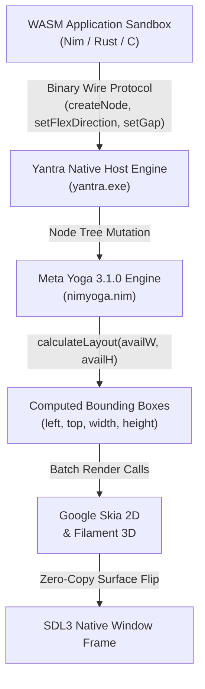

# Meta Yoga in Yantra OS

> **Meta Developer Hackathon Showcase**  
> How Meta's Yoga layout engine powers zero-overhead, sub-millisecond flexbox UI in a next-generation native operating system.

---

## 1. Why Meta Yoga?

Modern desktop operating systems face a critical dilemma:
1. **The Web Engine Bloat:** Electron and Chromium-based frameworks carry over **150 MB to 200 MB of baseline RAM overhead** and gigabytes of disk footprint per window just to compute CSS flexbox layouts and render DOM trees.
2. **Traditional Native Toolkits:** Win32, AppKit, or Qt introduce rigid layout semantics, steep learning curves, and massive non-portable C++ dependencies.

**Yantra OS bridges this divide using Meta's Yoga 3.1.0.**
By embedding Yoga directly into the native host engine via high-performance Nim bindings (`nimyoga`), Yantra delivers standard CSS Flexbox semantics (row/column flow, flex-grow, gutters/gaps, padding, justify-content) with:
- **Sub-microsecond layout calculation times**
- **Zero browser engine dependencies**
- **Ultra-compact binary footprint** (Yoga's C core is embedded directly into the native runtime)
- **Hermetic sandbox safety** (applications run as WebAssembly sandboxes and declare layout trees via an efficient binary wire protocol).

---

## 2. Architecture & Integration Flow



### Layout Lifecycle:
1. **Tree Declaration:** Sandboxed applications emit UI blocks (e.g. `col:`, `row:`, `gap = 12.0`, `padding = 16.0`).
2. **Incremental Yoga Node Caching:** The native engine maintains a persistent shadow tree of `YogaNode` references. Unchanged layout subtrees are preserved across frames (`copyStyle` / `isDirty`).
3. **Layout Resolution:** On resize or state mutation, `calculateLayout(availableWidth, availableHeight)` resolves full window dimensions deterministically in fractions of a millisecond.
4. **Drawing:** Positions `(left, top, width, height)` are piped directly to Skia / GPU canvas drawing routines.

---

## 3. Idiomatic Nim Interface (`INTERFACE.md`)

The `libs/nimyoga` wrapper wraps Yoga's C API into a clean, safe, type-checked Nim layer:

```nim
import nimyoga

# Create a responsive flexbox container
let root = newNode()
root.setFlexDirection(fdColumn)
root.setWidth(800.0)
root.setHeight(600.0)
root.setGap(gutterRow, 12.0)

# Add child item with flex grow
let header = newNode()
header.setHeight(60.0)
root.insertChild(header, 0)

let content = newNode()
content.setFlexGrow(1.0)
root.insertChild(content, 1)

# Deterministic layout pass
root.calculateLayout(800.0, 600.0)

let layout = content.layout()
echo "Content bounds: ", layout.left, ", ", layout.top, " (", layout.width, "x", layout.height, ")"
```

---

## 4. Test Verification

Layout correctness is continuously verified via pure unit tests (`t_layout.nim`) covering:
- Row and column directional flow
- Proportional space distribution (`flexGrow`)
- Uniform and directional padding
- Gutter/gap spacing calculations
- Nested hierarchy coordinate inheritance
